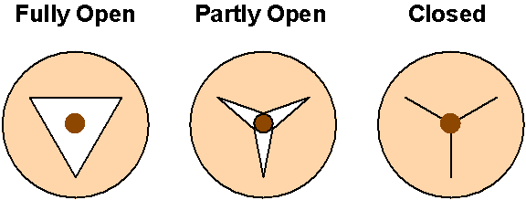
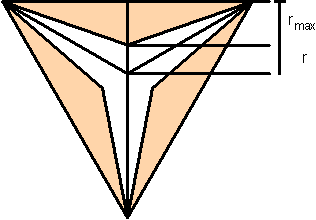
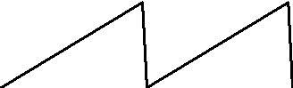
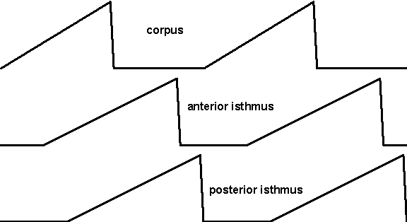
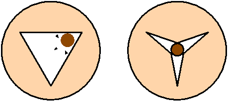
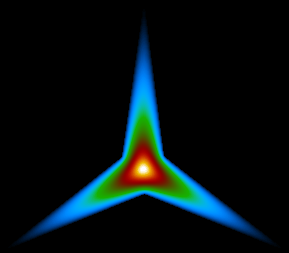
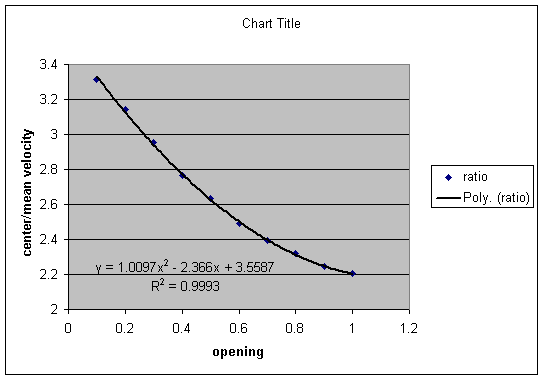

# Pharynx Simulation

To start the simulation, just click the button.

This Java Applet requires the Java 1.3 browser plug-in from Sun Microsystems, which you probably don't have.  To get it, you need to install [the Java 2 Runtime Environment](http://java.sun.com/products/plugin/1.3/plugin-install.html).

(The applet can also be easily run from the home page [http://eatworms.swmed.edu/~leon/pharynx_sim/](http://eatworms.swmed.edu/~leon/pharynx_sim/).
-- Leon Avery.)

(Note from the ModelDB administrator:
I was able to run the simulations directly at Leon's web site or by downloading this zip file, expanding it and then opening the
.\pharynx_sim\source\pharynx\PharynxSim1Applet.html file in internet explorer and pressing the start button. I then had to click the bar that appeared that would allow blocked content. I have the Java 2 Platform Standard Edition Version 1.5.0 running under Windows XP. We recommend going to Leon's site to easily run the simulation from your browser.)

The home page for this simulation is [http://eatworms.swmed.edu/~leon/pharynx_sim/](http://eatworms.swmed.edu/~leon/pharynx_sim/).  The sources are available [here](source/).  PharynxSim1 can be run standalone.  There is no real documentation for the program.  [A description of the model and results has been published in *J Exp Biol*.](paper.pdf) Below is a handout that I wrote for a lab meeting.

## The problem

The pharynx takes in bacteria suspended in liquid, traps the bacteria, and expels the liquid. As pumping continues, the bacteria are efficiently moved posteriorly towards the intestine where they can be turned into more worms. How does this work?

I made two assumptions about how bacteria move in the pharynx:

1. When the lumen closes down to less than the diameter of the bacteria, the bacteria can’t move.

2. When they are free to move, the bacteria move with the fluid.

These are not controversial. Later, I’ll add one more assumption:

3. The bacteria stay in the center of the pharyngeal lumen.

This one takes a little more justification, but I think it’s plausible.

Are these assumptions sufficient to explain the trapping and transport of bacteria? To find out, I wrote a program simulating the motions of bacteria within the pharyngeal lumen.

## Setting up the simulation

The pharyngeal lumen is triradiate. When closed, it forms a Y-shape. There’s no easy way to see it open, but it probably pulls out to an approximately triangular shape. In these pictures the size of the lumen relative to the pharynx is exaggerated. The bacterium on the left is free to move; in the two middle pictures it is trapped. Fluid can move around it in the partly closed shape.

The picture to the left shows how I formalize the geometry and motions. The pharyngeal lumen has a maximum radius *rmax* to which it can open, which varies along its length. It’s biggest in the metacorpus and smallest in the isthmus. At any given time it’s open to some radius *r*, which varies between 0 and *rmax* with time. I define the opening, *o*, as the ratio of *r* to *rmax*. *o* varies from 0 to 1: 0 means the lumen is closed and 1 means it’s open. A bacterium is held whenever *r* is less than the radius of the bacterium. When *r* is greater than the radius of the bacterium, the bug is free to move with the fluid.

 

For the first simulation, let’s just make the simple assumption (which is approximately true) that the whole pharynx contracts and relaxes together. That’s the same as saying that *o*, although it varies with time, is the same everywhere along the length of the pharynx. To make the math simple, I assume that *o* is piecewise linear — the motion is linear with time except at a few points where it abruptly changes. I modeled it as a sawtooth with the contraction lasting 167 ms and the relaxation lasting 5 ms. (Those numbers come from videotapes.)

Now all we need to do is figure out how the fluid moves. During the regular pump, the posterior isthmus remains closed, so no fluid flows through it. So as the corpus and anterior isthmus contract, the lumen has to fill with fluid flowing in through the mouth. So, the volume in ml that flows into the mouth during 1 ms has to equal the amount by which the volume of the pharyngeal lumen from the mouth to the middle of the isthmus changed in that 1 ms. The volume of a little section of the pharyngeal lumen is just the cross-sectional area of that section times its length. The way I’ve defined *o*, cross-sectional area is proportional to it. So, it’s straightforward to add up all the volume changes along the length of the pharynx to get the rate of flow into the mouth in ml/ms. In the same way, you can get the flow through any cross-section of the pharynx by adding up the volume change posterior to that point. This gives us the flow as volume/time. But to figure out how the bugs move, we need to know the flow velocity, which has units of distance/time (mm/ms). To calculate this, you just divide the flow by the cross-sectional area. (This gives the *mean* flow velocity, i.e., the rate at which an *average* water molecule moves.)

## First simulation: fully reversible, mean flow velocity

OK, that’s all we need to know to run the simulation. We try it, and guess what? It doesn’t work. The bacteria come into the pharynx when it contracts, and they go right back out again when it relaxes.

Actually, I didn’t need to write a simulation program to figure out that this wouldn’t work. The problem is that the relaxation motions are the precise reverse of the contraction motions, except for speed. That means that the particle motions during relaxation are also the precise reverse of those during contraction: they come in, then they go out. This is actually a very general problem, not just a consequence of the details of the way I’ve set up the simulation. In any flow system small enough that inertia can be ignored, motions are fluid motions are linear with the driving forces and completely reversible. It is impossible for the pharynx to achieve net motion of the bacteria if the relaxation is the reverse of the contraction. That was actually the puzzle that got me started on this whole simulation problem. It’s also the reason why, when I talk about this at seminars, etc, people always want to believe that something very cool and tricky is going on: for instance that the walls of the lumen change their properties during the pump such the bacteria stick when it’s relaxing but not when it’s contracting.

## Second simulation: delayed isthmus, mean flow velocity

I’ve never liked those ideas, so I looked for some sort of non-reversibility. If you look more closely at the pharynx, you find that the corpus does seem to contract and relax as a unit, even in high-speed videos made by Lars Phillipson. However, the anterior isthmus is slightly delayed with respect to the corpus. Furthermore, the contraction actually propagates in a wave from the anterior to the middle isthmus, and I think the relaxation does as well. So, the motions are actually like this:

You can see that this does create some irreversibility in the motions. The isthmus is closed while the corpus contracts, but it is open while it relaxes. And it works. It traps bacteria and moves them posteriorly. However, it doesn’t work very well. Not many bacteria are trapped, and the posterior movement is painfully slow.

The problem is that the volume of the anterior isthmus is very small compared to the entire corpus, so that the amount of extra backward movement the bugs get from that source is small. Here’s a way to think about this: imagine that the corpus opens fully, then the isthmus opens fully, then the corpus closes fully, then the isthmus closes fully. When the corpus opens, the bacteria get sucked way in. Then the isthmus opens, and they get sucked in just a little further. Then the corpus closes, and they move way anterior, but not quite to the mouth because of that extra little bit of backward motion that happened when the isthmus opened. Finally, the isthmus closes, but the bacteria don’t move because the corpus is closed and they’re trapped.

Again, it wasn’t really necessary to do the simulation to see that this would happen.

## Third simulation: isthmus delayed, twice mean flow velocity

Is there any way to magnify the effect of the isthmus? It occurred to me that there is (and this was the thing that increased the complexity to where I had write the simulation to see what would happen). Because of the shape of the pharyngeal lumen, bacteria should be pushed to the center as it closes:

When it opens again, they should stay in the center, as long as the opening is symmetrical. Therefore, one would expect that after the first pump, the bacteria would always be in the center. Now, fluid velocity is not the same everywhere in a tube. It’s very slow at the edges because of friction with the walls, and it’s fastest in the center. This might enhance the separation of bacteria from fluid, because, although the bacteria are still moving with the fluid in their vicinity, they are moving faster than the *average* water molecule. However, it’s not obvious that it’ll help, because it speeds up the anterior movement just as much as the posterior.

The exact ratio of the center velocity to the mean velocity depends on the shape of the tube. For an ordinary tube with a circular cross-section, it is exactly 2. (The simulation doesn’t wait until the first pump — it assumes the bacteria are in the center the whole time.)

This improves performance a great deal.

## Fourth simulation: isthmus delayed, center flow velocity

Since the ratio of center to mean flow velocity depends on the shape of the tube, the factor 2 is actually not correct for the pharyngeal lumen. To figure out the actual pattern of flow in a tube of arbitrary shape you have to solve a differential equation called Poisson’s equation. In a lab meeting so long ago that not a single person who attended (other than me) is still here, I described a method I worked out to do this. Here’s what the solution looks like for the pharyngeal lumen at *o* = 0.3:

 

At this opening, center flow velocity is 2.95 times the mean. I did this for 10 openings from 0.1 to 1 (you can’t do it for 0) and got the following curve:

This is fit pretty well by a quadratic. This function can be used in the simulation.

This works *very* well — in fact, it seems to work as well as the real thing. The surprising thing is, it seems to improve things by a lot better than a factor of 1.65 (= 3.3 / 2). I believe I understand why this is. If you think about the pharynx when the corpus is closing, liquid is flowing posteriorly in the isthmus, but anteriorly in the corpus. Therefore there must be a dead zone: a place where the fluid is not moving either way. This place is just anterior to the boundary between the isthmus and corpus. Once a bacterium gets posterior to the dead zone, it can never cross it again. And the closer a bacterium gets to the dead zone, the lower the flow velocity will be when the corpus relaxes, and therefore the less its anterior movement will be. So the accelerated center flow velocity magnifies the effect of the small delayed isthmus volume.

## Summary

Working together, two influences, delayed anterior isthmus motion and center flow, produce a much bigger effect than either alone. In fact, they seem to be good enough to account for bacterial trapping and transport.

---

# Set-ups for the four simulations

## Set-ups for the particle series

Series 1: Type = **bacterium**, diameter = 4, number = 0 or 10, place at = 0, start = 40, interval = 10, acceleration = 1.0.

Series 2: Type = **accelerated**, diameter = 4, number = 10, place at = 0, start = 40, interval = 10, acceleration = **1.0**.

Series 3: Type = **accelerated**, diameter = 4, number = 0 or 10, place at = 0, start = 40, interval = 10, acceleration = **2.0**. May need to change color to make this series easily visible.

The number of particles is 0 for the simulations in which that series is not used, 10 for the simulations in which it is used, as listed below.

## Simulation 1:

Corpus motions start = 0, peak = 167, end = 172, anterior isthmus motions start = 0, peak = 167, end = 172, posterior isthmus motions start = 0, peak = 167, end = 172. Series 1 number = 0, Series 3 number = 0.

## Simulation 2:

All motion settings at defaults (corpus motions start = 0, peak = 167, end = 172, anterior isthmus motions start = 67, peak = 267, end = 272, posterior isthmus motions start = 100, peak = 300, end = 305). Series 1 number = 0, Series 3 number = 0.

## Simulation 3:

All motion settings at defaults. Series 1 number = 0, Series 3 number = **10**.

## Simulation 4:

All motion settings at defaults. Series 1 number = **10**, Series 3 number = **10**.

---

2025-05-27 – Standardized to Markdown.
